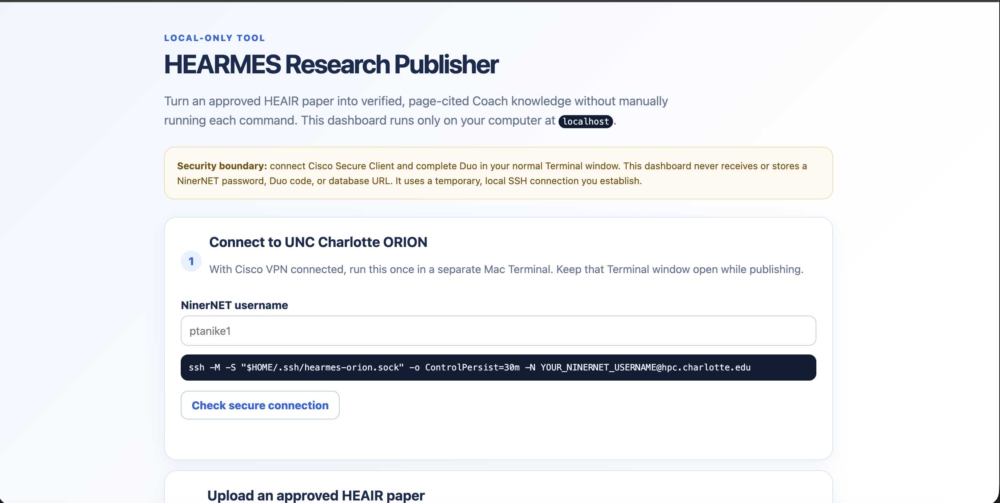

# HEARMES-Research-Publisher

Local-only publishing dashboard for adding **approved, non-sensitive research PDFs** to the shared HEARMES AI Coach retrieval collection. It sends the PDF through UNC Charlotte ORION as a scheduled Slurm job, creates a versioned and integrity-checked artifact with page metadata, validates it locally, then performs an explicit import into the existing Neon-backed Coach collection.



## What it does

1. Accepts an approved research paper or best-practice PDF in a dashboard running only at `127.0.0.1:3060`.
2. Uses an SSH connection you establish separately through Cisco Secure Client and Duo.
3. Copies the PDF to your ORION home storage and submits a small CPU Slurm job.
4. Extracts text, splits it into overlapping searchable chunks, preserves PDF page numbers, and writes a versioned JSON artifact with integrity checksum.
5. Copies the completed artifact back to your Mac and validates it before import.
6. Imports it into the existing shared HEARMES Coach retrieval collection. The live Coach can show the actual paper title, citation, and PDF page in its sources.

The dashboard never receives or stores a NinerNET password, Duo code, VPN credential, or Neon connection string. It does not process participant data, assessment responses, private Coach uploads, confidential policies, or chat history.

## Prerequisites

- A Mac with Cisco Secure Client and a working UNC Charlotte ORION account.
- Your NinerNET username, password, and Duo device.
- Git, Node.js 20+, and Python 3 locally.
- Authority to add the document to the shared HEARMES research corpus.
- The existing HEARMES Neon database connection string. Keep it private; it belongs only in the Terminal session that launches this tool.

> This is an offline research-publication workflow. ORION is **not** a public, always-on Coach API. The public HEARMES website keeps using its existing backend and loads the validated records after import.

## First-time ORION setup — Terminal 1

Connect Cisco Secure Client first. Then run these once from a normal Mac Terminal. Complete the password and Duo prompts there.

```bash
ssh YOUR_NINERNET_USERNAME@hpc.charlotte.edu

cd /users/YOUR_NINERNET_USERNAME
git clone https://github.com/tanikellapratik23/HEARMES-Research-Publisher.git
cd HEARMES-Research-Publisher

module load node.js/22.20.0
npm ci
npm run db:generate

python3 -m venv .venv-pdf
.venv-pdf/bin/python -m pip install pypdf

mkdir -p /users/YOUR_NINERNET_USERNAME/hearmes-inputs
mkdir -p /users/YOUR_NINERNET_USERNAME/hearmes-artifacts
mkdir -p /users/YOUR_NINERNET_USERNAME/hearmes-logs
```

This stores code and the reusable Python environment in your backed-up home directory. The Slurm job uses temporary compute-node storage only for extracted intermediary files; it writes its final artifact to your durable ORION home directory.

## Publish a paper — three terminals

### Terminal 1: keep the secure ORION connection open

With Cisco Secure Client connected, run this on your **Mac**. Finish Duo in this Terminal. Leave the window open while using the dashboard.

```bash
ssh -M -S "$HOME/.ssh/hearmes-orion.sock" -o ControlPersist=30m -N YOUR_NINERNET_USERNAME@hpc.charlotte.edu
```

### Terminal 2: run the local dashboard

Open a **second Mac Terminal**:

```bash
git clone https://github.com/tanikellapratik23/HEARMES-Research-Publisher.git
cd HEARMES-Research-Publisher

npm ci
npm run db:generate

read -r -s 'DATABASE_URL?Paste the Neon DATABASE_URL: '
echo
export DATABASE_URL

npm run research:publisher
```

Open [http://127.0.0.1:3060](http://127.0.0.1:3060). Enter your NinerNET username, verify the secure connection, select the source category, add an exact title and citation, upload the approved PDF, then submit it. When ORION reports completion and the local integrity check succeeds, the **Import into Coach** button appears.

The connection string is hidden while you paste it. Do **not** type it into the browser, commit it to Git, or send it in chat. When finished, clear it from the shell with:

```bash
unset DATABASE_URL
```

### Terminal 3: optional ORION maintenance and logs

Use this **third Mac Terminal** if you need to update the ORION checkout or investigate a failed Slurm job:

```bash
ssh -S "$HOME/.ssh/hearmes-orion.sock" YOUR_NINERNET_USERNAME@hpc.charlotte.edu
cd /users/YOUR_NINERNET_USERNAME/HEARMES-Research-Publisher
git pull --ff-only
module load node.js/22.20.0
npm ci
npm run db:generate

# Replace JOB_ID with the number shown by the dashboard.
sacct -j JOB_ID --format=JobID,State,ExitCode,Elapsed,MaxRSS
cat /users/YOUR_NINERNET_USERNAME/hearmes-logs/research-publisher-JOB_ID.out
cat /users/YOUR_NINERNET_USERNAME/hearmes-logs/research-publisher-JOB_ID.err
```

## How Coach retrieval stays compatible

The current HEARMES live backend reads its shared research collection using the existing `heair_paper` database source class. This Publisher writes new approved research records to that compatible shared collection while preserving the paper’s own title, citation, page, section, and `research_paper` metadata. No production backend change is required for a newly imported source to become retrievable.

## Validation and rollback

- The tool will not enable import until the Slurm job finishes, the artifact downloads, its checksum verifies, and a local dry-run database validation passes.
- Re-publishing the same title and citation produces the same document ID, replaces only that document’s chunks, and does not duplicate them.
- If a source needs to be removed, use the existing HEARMES database administration procedure; this Publisher deliberately does not offer destructive shared-corpus deletion in the browser.
- Before relying on a new source, ask the live Coach a focused question and confirm the displayed title, citation, and page reference.

## Troubleshooting

- **“Secure ORION connection unavailable”**: connect Cisco Secure Client, run Terminal 1, finish Duo, and keep the terminal open.
- **“Missing .venv-pdf”**: complete the first-time ORION setup in Terminal 1 / the ORION login session.
- **Slurm failure**: inspect the two log files from Terminal 3. Do not run full processing directly on the login node.
- **Import button missing**: click **Refresh status** until ORION is complete; it appears only after the downloaded artifact passes local validation.
- **Database URL error**: stop the dashboard, export `DATABASE_URL` in Terminal 2, and restart it. Never place the URL in the browser.

## Development

```bash
npm ci
npm run db:generate
npm test
npm run build
```

